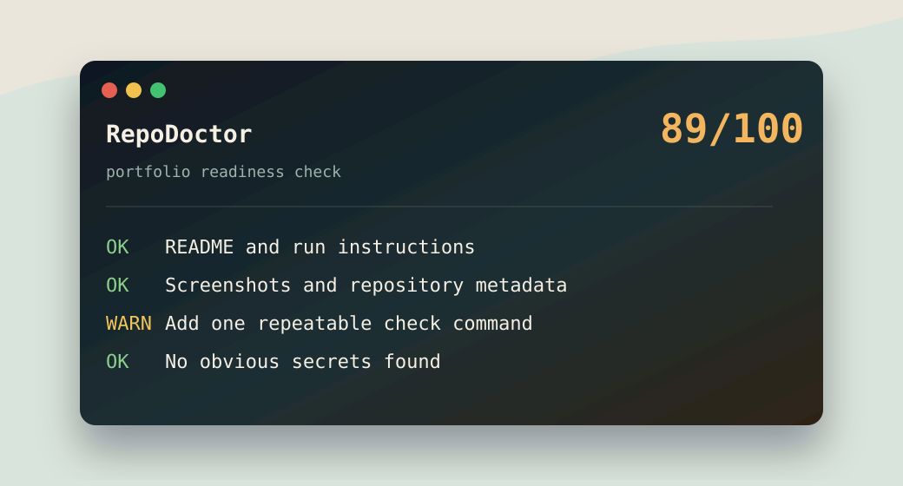

# RepoDoctor

RepoDoctor is a small CLI that audits a project folder and tells you what would make the repository feel more complete, safe, and portfolio-ready.

It is useful before publishing a GitHub project, sharing work on LinkedIn, or turning a school/demo project into something that looks professional.



## What It Checks

- Git repository status.
- README presence and run instructions.
- Screenshots or visual assets.
- License and `.gitignore`.
- Project metadata such as `package.json` or `requirements.txt`.
- Test/check scripts.
- Obvious secrets or risky environment files.

## Install From GitHub

```bash
npm install -g https://github.com/Alfredo-ctrl/repodoctor/archive/refs/heads/main.tar.gz
```

## Usage

Audit the current folder:

```bash
repodoctor
```

Audit another project:

```bash
repodoctor C:\Path\To\Project
```

Export JSON:

```bash
repodoctor --json
```

Write a Markdown report:

```bash
repodoctor --markdown --output repo-health-report.md
```

## Example Output

```text
RepoDoctor

Score: 78/100
Status: healthy

Checks
OK   README
WARN Screenshots
WARN License
OK   Git ignore
```

## Why It Helps

A good portfolio repo is not just code. It needs clear instructions, proof that it runs, visual context, and no accidental sensitive files. RepoDoctor gives a fast checklist before pushing.

## Author

Alfredo Oliva
